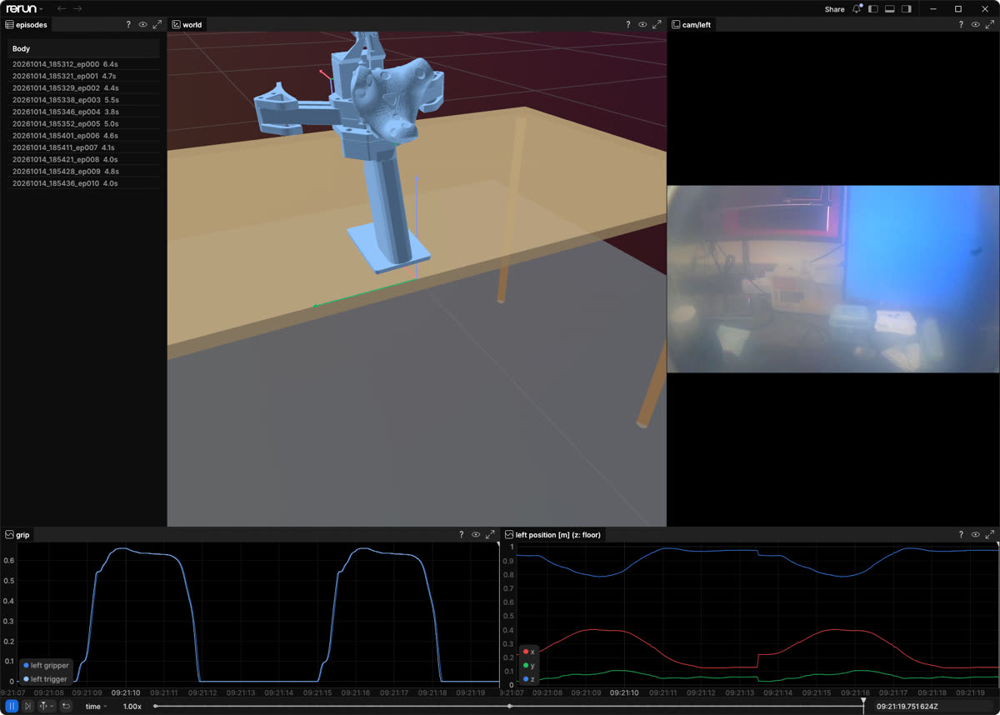
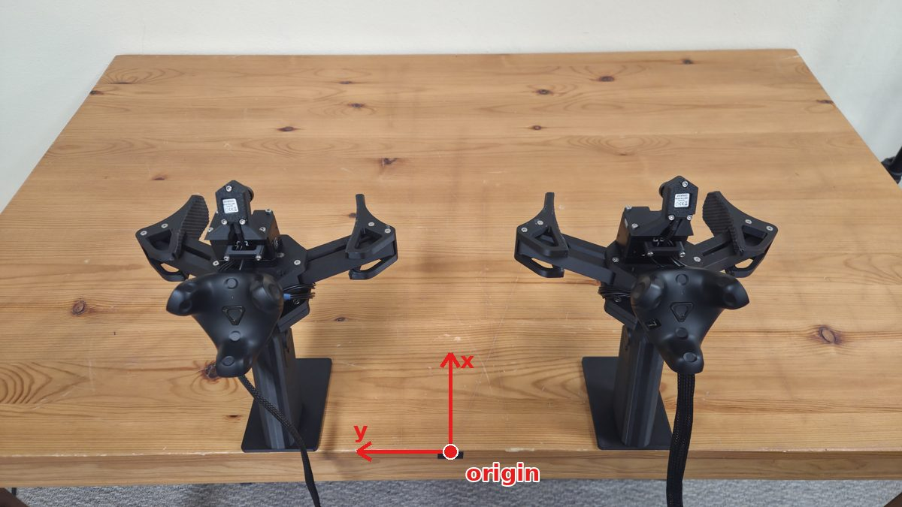

# UMI 데이터 수집

Vive 트래커 + 다이나믹셀 트리거 그리퍼 + USB 손목 카메라를 동시에 기록해서 GR00T N1.7 학습 데이터셋으로 변환.\
한손 또는 양손 가능.

## 장비

| 장치 | 연결 |
|---|---|
| Vive Tracker + USB 동글 (손당 1개), 베이스스테이션 (1개 이상) | SteamVR |
| 트리거 XC330-T181-T, 그리퍼 XM430-W350-T (손당 1쌍) | U2D2 (TTL) |
| 손목 카메라 (손당 1개, UVC, MJPG) | USB |
| BT 버튼 (손당 1개) | 블루투스 |

- 다이나믹셀은 한 버스에 데이지체인. ID 1~4 = 왼트리거, 왼그리퍼, 오른트리거, 오른그리퍼. 전원 12V.

## 1. 설치

Ubuntu 20.04, 24.04 테스트 완료.
```bash
sudo apt install -y git
git clone https://github.com/JY7/ARAI_UMI.git ~/ARAI_UMI
bash ~/ARAI_UMI/install.sh
```
1. 스크립트가 띄운 Steam 창: 로그인 → SteamVR '설치'
2. PC 로그아웃 → 다시 로그인 (포트·입력 장치 권한 적용 → `id -nG`에 `dialout`, `input` 있어야 함)
3. 스크립트 한 번 더 → 끝에 `SteamVR: OK (no-HMD config applied)`

**새 터미널마다 먼저 `umi` 입력** (`cd ~/ARAI_UMI && source .venv/bin/activate`의 단축 명령, install.sh가 등록. 프롬프트 앞에 `(.venv)`가 붙으면 됨). 안 하면 `ModuleNotFoundError`.

## 2. 장치 연결

**트래커** (처음 1회 페어링)
1. 베이스스테이션 설치
2. 트래커마다 USB 동글 1개씩 연결
3. SteamVR 실행: `nohup steam steam://rungameid/250820 >/dev/null 2>&1 &`
4. SteamVR 메뉴(≡) → Devices → Pair Controller → HTC Vive Tracker → 꺼진 트래커의 전원 버튼을 약 2초 눌러 켜기 (LED 파랑 깜빡임 = 페어링 대기)
5. LED가 초록이 되면 Done. 다음부터는 전원만 켜면 연결


**BT 버튼** (PC마다 1회, 버튼을 페어링 모드로 켠 뒤)
```bash
bluetoothctl
power on
scan on               # "Ulanzi RC05"의 MAC 확인 → scan off
pair <MAC>
trust <MAC>           # 다시 켜면 자동 재연결
connect <MAC>
exit
```

## 3. 설정 (`config.yaml`)

PC·장비마다 바꿀 값:

| 항목 | 값 찾기 | 키 |
|---|---|---|
| 사용 손 | | `hands` (`[right]` = 한손) |
| 트래커 | `umi && python3 collect.py --list-vive` (SteamVR 실행 중) | `vive.serials` |
| U2D2 포트 | `ls /dev/serial/by-id/` | `dynamixel.port` |
| 카메라 | `watch -n1 ls /dev/v4l/by-path/` 띄워 두고 한 대씩 꽂기 → 새로 생긴 것 중 `-usb-…-video-index0` | `cameras.<손>.device` |
| BT 버튼 | 버튼 연결 후 `umi && python3 collect.py --test-button` (켠 뒤 연결된 버튼은 안 보임) | `button.bluetooth.devices.<손>` (MAC은 따옴표로) |

예 (`config.yaml`에서 이 줄들만 바꿈, 경로는 `ls`에 나온 이름 앞에 폴더까지):
```yaml
hands: [left, right]
vive:
  serials:
    left: LHR-0AB89868
    right: LHR-E0EC229E
dynamixel:
  port: /dev/serial/by-id/usb-FTDI_USB__-__Serial_Converter_FT89FAJ1-if00-port0
cameras:
  left:
    device: /dev/v4l/by-path/pci-0000:00:14.0-usb-0:4:1.0-video-index0
  right:
    device: /dev/v4l/by-path/pci-0000:00:14.0-usb-0:3:1.0-video-index0
button:
  bluetooth:
    devices:
      left: "26:07:02:F5:1C:45"
      right: "26:07:02:F5:05:0B"
```

- 포트·카메라는 `/dev/ttyUSB0`, `/dev/videoN` 대신 위 경로로 (다시 꽂으면 번호가 바뀜). 카메라 경로는 USB 포트 위치라 항상 같은 포트에 꽂기.
- 카메라 화면이 어둡거나 색이 이상하면 (`cameras.<손>`):
  - 어두움 → `gamma` 올림 (100~300). `exposure`(노출 시간, 100µs 단위)를 늘리면 움직일 때 흐려지고, 333을 넘으면 30fps가 안 나옴
  - 노랗게 나옴 → `wb_temp` 낮춤, 파랗게 나옴 → 올림 (2800~6500 K)

## 4. 캘리브레이션 (최초 1회)

| 명령 | 방법 | 다시 할 때 |
|---|---|---|
| `umi && python3 collect.py --calib-dxl` | 1. Enter → 그리퍼가 약하게 열림 끝·닫힘 끝까지 움직임 (손가락 주변 비우기)<br>2. 트리거 확인 화면: 놓으면 0%, 끝까지 당기면 100% 근처인지 확인 → Enter (안 맞으면 그 손의 `trigger_closed`를 끝까지 당겼을 때 raw 값으로) | 모터 교체 |
| `umi && python3 collect.py --calib-mount` | SteamVR 실행 중.<br>1. 자세 A: 그리퍼 끝이 바닥을 향하게 세워 들기<br>2. 자세 B: 평소 잡는 자세 (손잡이 아래, 그리퍼 끝은 수평으로 앞)<br>자세마다 Enter 후 1.5초 정지 | 트래커 재장착 |

값은 `config.yaml`에 저장. 그리퍼 값이 `null`이면 수집이 시작되지 않음.

## 5. 테스트

```bash
umi
python3 collect.py
```
실행하면 Rerun 창(뷰어)이 뜸: 가운데 3D 화면(world)에 그리퍼, 오른쪽에 카메라, 아래에 그리퍼 열림·트리거 그래프와 손별 그리퍼 끝 위치(x·y·z) 그래프.



1. 터미널에 빨간 글자 없음 (`tracker lost`, `grip --`, `cam … lost`, `button … lost` 등. 노란 `no origin`은 원점 설정 전이라 정상)
2. 버튼 빠르게 2번(또는 키보드 `o`) → 원점 설정 (아래 그림) → 3D 화면에 테이블이 나오고 그리퍼가 실제와 같이 움직임
3. 트리거를 당기면 그리퍼가 따라 닫힘
4. 카메라 좌우 확인

| 입력 | 동작 |
|---|---|
| 버튼 1번 / `space` | 녹화 시작·정지 |
| 버튼 빠르게 2번 / `o` | 원점 설정 |
| 버튼 빠르게 3번 / `d` | 현재(또는 직전) 에피소드 삭제 (되돌릴 수 없음) |
| `t` / `q` | task 변경 / 종료 (Rerun 창을 닫아도 종료, mp4 압축이 끝날 때까지 기다림) |

**원점 = 테이블 모서리 중점, 테이블 면**



- 손잡이 바닥을 책상에 평평하게 세우고, 바닥 뒤 모서리를 테이블 모서리에 맞춤. 손가락은 테이블 안쪽, 모서리와 수직.
- 양손: 두 그리퍼 사이 중점이 원점 → 모서리 중점 기준 좌우 대칭. 한손: 모서리 중점.
- 베이스스테이션을 옮기면 다시 설정.

## 6. 수집

```bash
umi
python3 collect.py --data cup         # data/cup에 저장
```
1. 원점 설정 (세션 시작 때 한 번. 원점 없이 녹화한 에피소드는 변환에서 빠짐)\
   그리퍼를 테이블 모서리에 세움 (5번 그림) → 버튼 빠르게 2번 누르기(또는 키보드 `o`) → 1초 가만히 → "origin set" 음성.
2. 녹화 시작하기\
   버튼 1번 누르기(또는 키보드 `space`) → "start" 음성 → 작업 시작.
3. 녹화 끝내기\
   작업 끝 → 버튼 1번 누르기(또는 키보드 `space`) → "stop" 음성.
4. 잘못 녹화했으면 삭제 (되돌릴 수 없음)\
   버튼 빠르게 3번 누르기(또는 키보드 `d`) → "discard" 음성. 녹화 중이면 지금 에피소드, 아니면 직전 에피소드 하나만 삭제.
5. 다음 에피소드는 2번부터 반복.

문제가 생기면:
- "tracking changed, set origin again" 음성(SteamVR이 자기 좌표계를 바꿨다는 알림) → 원점 다시 설정 필요 (녹화 중이었으면 그 에피소드는 자동 삭제).
- 카메라가 빠짐 → collect 재실행 (원점 유지).

## 7. 데이터셋 변환

```bash
umi
python3 replay.py cup             # 재생 (Rerun 창)
python3 check_episode.py cup      # 시간 정렬 → aligned.npz, check.png
python3 to_gr00t.py cup           # → ~/datasets/cup (--out으로 변경)
```
- 안 쓸 에피소드는 폴더 이름 끝에 `_DISCARDED` (빠지는 에피소드와 이유는 `to_gr00t`가 출력).

## 데이터 형식

GR00T LeRobot v2.1, embodiment tag `NEW_EMBODIMENT`, modality config = 데이터셋 폴더의 `umi_modality_config.py`.

| 항목 | 내용 |
|---|---|
| video | 손별 `<hand>_wrist`, 짧은 변 256 (1280×720 → 456×256), 30fps |
| state | 손별 `<hand>_eef` = xyz + rot6d (회전행렬 앞 두 행, 9) / `<hand>_gripper` = 측정 위치 (0 열림 ~ 1 닫힘) |
| action | 같은 키, 16 step (0.53초). eef는 현재 TCP 기준 상대 pose (GR00T가 변환), gripper는 트리거 지령 |
| language | `config.yaml`의 `task` |
| 좌표계 | 원점 (테이블 모서리 중점, x 앞 / y 왼쪽 / z 위) 기준 TCP |
